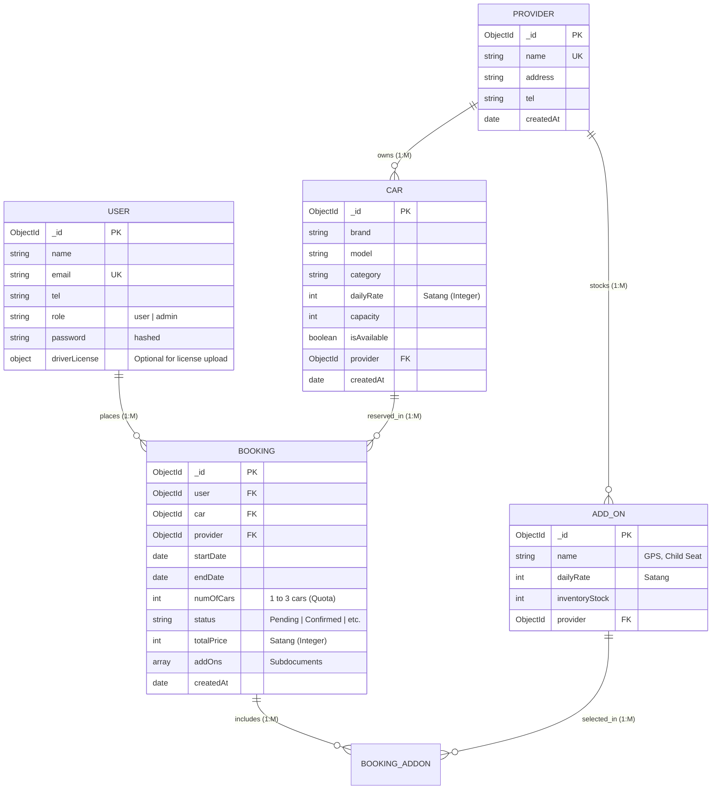

# API Contracts & Data Models Reference

This document serves as the shared technical contract and data dictionary for the **Rental Car Booking Platform** backend API.

---

## 1. Global Conventions & Design Rules

### 1.1 Currency Representation (Fixed-Point Arithmetic)
- **Unit**: **Satang (Integer)**.
- **Conversion**: `100 Satang = 1.00 THB`.
- **Rationale**: Adheres to the Fixed-Point Arithmetic requirement to prevent IEEE 754 floating-point rounding errors when calculating taxes (VAT 7%) and rental fees.
- **Example**:
  - A daily rate of **1,500 THB** is stored and sent via API as `150000`.
  - Frontend/Client is responsible for dividing by `100` when formatting for display.

### 1.2 Naming Conventions
- **Telephone**: Always use the field name **`tel`**, NOT `telephone`.
- **References**: Foreign keys use camelCase singular resource names (`user`, `car`, `provider`).

### 1.3 Authentication & RBAC
- **Token**: Bearer token passed in the `Authorization` header (`Bearer <token>`) or `token` cookie.
- **Roles**:
  - `'user'`: Standard customer.
  - `'admin'`: Platform administrator.

---

## 2. Core Mongoose Models



---

### 2.1 User Model (`models/User.js`)

| Field | Type | Validation / Rules | Notes |
| :--- | :--- | :--- | :--- |
| `_id` | `ObjectId` | Auto-generated PK | |
| `name` | `String` | Required | |
| `tel` | `String` | Required | Standardized `tel` identifier |
| `email` | `String` | Required, Unique, Email Regex | Unique user credential |
| `role` | `String` | Enum: `['user', 'admin']` | Default: `'user'` |
| `password` | `String` | Required, Min 6 chars, `select: false` | Bcrypt hashed with salt 10 |
| `driverLicense` | `Object` | Optional | Reserved for License Upload feature (`idNumber`, `imageUrl`, `verified`) |
| `createdAt` | `Date` | Default: `Date.now` | |

> **Security Note**: `UserSchema.pre('save')` includes `if (!this.isModified('password')) return next();`. This guarantees that updating profile attributes (e.g., driver license image) does NOT re-hash an already hashed password.

---

### 2.2 Provider Model (`models/Provider.js`)
*Foundational Schema Contract. Provider CRUD and caching operations will extend from this base.*

| Field | Type | Validation / Rules | Notes |
| :--- | :--- | :--- | :--- |
| `_id` | `ObjectId` | Auto-generated PK | |
| `name` | `String` | Required, Unique, Max 100 chars, Trim | Provider company name |
| `address` | `String` | Required | Physical branch address |
| `tel` | `String` | Required | Contact telephone |
| `createdAt` | `Date` | Default: `Date.now` | |
| *`cars`* | *Virtual* | Reverse populate | `ref: 'Car', localField: '_id', foreignField: 'provider'` |

---

### 2.3 Car Model (`models/Car.js`)

| Field | Type | Validation / Rules | Notes |
| :--- | :--- | :--- | :--- |
| `_id` | `ObjectId` | Auto-generated PK | |
| `brand` | `String` | Required, Max 50 chars, Trim | E.g., `'Toyota'` |
| `model` | `String` | Required, Max 50 chars, Trim | E.g., `'Camry'` |
| `category` | `String` | Enum: `['Sedan', 'SUV', 'Hatchback', 'Van', 'Truck', 'Luxury', 'Electric']` | Validated vehicle categories |
| `dailyRate` | `Number` | Required, Min: 0, **Integer in Satang** | `150000` = 1,500.00 THB |
| `capacity` | `Number` | Required, Min: 1, Default: 4 | Passenger seat count |
| `isAvailable` | `Boolean` | Default: `true` | Vehicle availability flag |
| `provider` | `ObjectId` | Ref: `'Provider'`, Required | Owning rental provider |
| `createdAt` | `Date` | Default: `Date.now` | |
| *`bookings`* | *Virtual* | Reverse populate | `ref: 'Booking', localField: '_id', foreignField: 'car'` |

- **Compound Indexes**:
  - `{ provider: 1, category: 1, isAvailable: 1 }` (Provider catalog sub-200ms real-time category filtering)
  - `{ isAvailable: 1, category: 1 }` (Global search real-time category aggregation with proper prefix)
  - `{ isAvailable: 1, dailyRate: 1 }` (Availability and price range sorting/filtering)
  - `{ brand: 1, model: 1 }` (Keyword search indexing preventing COLLSCAN)

---

### 2.4 Booking Model (`models/Booking.js`)

| Field | Type | Validation / Rules | Notes |
| :--- | :--- | :--- | :--- |
| `_id` | `ObjectId` | Auto-generated PK | |
| `user` | `ObjectId` | Ref: `'User'`, Required | Renter user ID |
| `car` | `ObjectId` | Ref: `'Car'`, Required | Reserved car ID |
| `provider` | `ObjectId` | Ref: `'Provider'`, Required | Rental provider ID |
| `startDate` | `Date` | Required | Rental pickup date |
| `endDate` | `Date` | Required | Rental return date |
| `numOfCars` | `Number` | Required, Min: 1, **Max: 3** | **Enforces 3-car quota limit** |
| `status` | `String` | Enum: `['Pending', 'Confirmed', 'Active', 'Completed', 'Cancelled']` | Default: `'Pending'` |
| `totalPrice` | `Number` | Min: 0, Default: 0, **Integer in Satang** | `300000` = 3,000.00 THB |
| `addOns` | `Array` | Subdocuments: `{ addOn: ObjectId (ref 'AddOn'), quantity: Number, price: Number }` | Reserved for Add-on inventory & locking |
| `createdAt` | `Date` | Default: `Date.now` | |

- **Compound Indexes**:
  - `{ user: 1, status: 1 }` (Accelerates user quota queries)
  - `{ car: 1, startDate: 1, endDate: 1 }` (Accelerates car availability queries)

---

## 3. Implemented API Endpoints

### 3.1 Authentication (`/api/v1/auth`)
| Method | Endpoint | Access | Description |
| :--- | :--- | :--- | :--- |
| `POST` | `/api/v1/auth/register` | Public | Register new user (`name`, `tel`, `email`, `password`). Server enforces `role: 'user'` to prevent privilege escalation. |
| `POST` | `/api/v1/auth/login` | Public | Login with `email` and `password`, returns JWT token and cookie |
| `GET` | `/api/v1/auth/me` | Private | Get profile of logged-in user |
| `POST` | `/api/v1/auth/logout` | Public | Clears authentication cookie |

### 3.2 Cars Resource (`/api/v1/cars`)
| Method | Endpoint | Access | Description |
| :--- | :--- | :--- | :--- |
| `GET` | `/api/v1/cars` | Public | List cars with filtering (`?category=Sedan`), sorting (`?sort=dailyRate`), pagination (`?page=1&limit=10`), and populated `provider` + `bookings` |
| `GET` | `/api/v1/cars/search` | Public | High-performance search and aggregation pipeline (Adv Req 2). Returns paginated vehicle results and dynamic real-time counts across all 7 vehicle categories (`Sedan`, `SUV`, `Hatchback`, `Van`, `Truck`, `Luxury`, `Electric`) in under 200ms using MongoDB `$facet` supported by compound indexes `{ provider: 1, category: 1, isAvailable: 1 }`, `{ isAvailable: 1, category: 1 }`, `{ isAvailable: 1, dailyRate: 1 }`, and `{ brand: 1, model: 1 }`. Category counts dynamically reflect active search filters (faceted search). Supports safe escaped keyword text search (`?keyword=` on brand/model), category filters (`?category=`), scalar and range operator filters on `dailyRate` (in Satang) and `capacity`, provider scoping (`?provider=`), and dynamic sorting (`?sort=`, defaults to `-createdAt`). Returns clean standard response envelope `{ success: true, count, total, pagination, categoryCounts, data }` with zero diagnostics leakage; failures strictly follow two-key `{ success: false, message }` format. |
| `GET` | `/api/v1/cars/:id` | Public | Get single car with populated `provider` and virtual `bookings` |
| `POST` | `/api/v1/cars` | Private (Admin) | Create new car with schema-enforced validations and Satang rate |
| `PUT` | `/api/v1/cars/:id` | Private (Admin) | Update car attributes with schema validators |
| `DELETE` | `/api/v1/cars/:id` | Private (Admin) | Delete car with **cascading delete** of associated bookings |

---

## 4. Input & Business Validation (Hybrid Architecture)

The system employs a **Hybrid Validation Architecture** combining schema-level data integrity (Instructor Pattern) with dedicated business rule validation middleware:

1. **Schema-Level Data Integrity (`models/`)**: Mongoose Schemas handle formatting, string trimming (`trim: true`), case normalization (`lowercase: true`), regex validation, and data type coercion natively.
2. **Business Validation Middleware (`middleware/validate.js`)**: Intercepts requests before reaching core logic to enforce temporal and operational constraints (e.g., date ordering, non-past dates, duration limits, and quota bounds).
3. **Clean Route Signatures (`routes/`)**: Route definitions remain clean and idiomatic, delegating business validation to middleware where appropriate and field integrity to Mongoose schemas.

### 4.1 Error Response Standard
When validation fails, endpoints respond with HTTP `400 Bad Request`:
```json
{
  "success": false,
  "message": "Specific error explanation"
}
```

### 4.2 Validation Rules & Field Specifications

| Layer | Resource / Field | Constraint / Rule | Rejection / Validation Behavior |
| :--- | :--- | :--- | :--- |
| **Schema** | `User.name` | String, 2–50 characters, auto-trimmed | `"Please add a name"`, max 50 chars |
| **Schema** | `User.tel` | 10 digits Thai format (`^0[0-9]{9}$`), auto-trimmed | `"Please add a valid 10-digit Thai phone number (0xxxxxxxxx)"` |
| **Schema** | `User.email` | RFC 5322 regex format, auto-trimmed, lowercased | `"Please add a valid email"` |
| **Schema** | `User.password` | String, min length 6, hashed with bcrypt | `"Please add a password"` (min length 6) |
| **Schema** | `User.role` | Enum: `['user', 'admin']` (enforced `'user'` on public registration) | Whitelist validation |
| **Schema** | `Car.category` | Enum: `['Sedan', 'SUV', 'Hatchback', 'Van', 'Truck', 'Luxury', 'Electric']` | Whitelist validation |
| **Schema** | `Car.dailyRate` | **Positive Integer in Satang** (`Number.isInteger`, `min: 1`) | `"Daily rate must be an integer in Satang (e.g. 150000)"` |
| **Schema** | `Car.capacity` | Integer >= 1 (default 4) | `"Capacity must be at least 1 person"` |
| **Schema** | `Booking.numOfCars` | Integer between 1 and 3 | **Enforces 3-car quota limit per booking** |
| **Schema** | `Booking.endDate` | Must be on or after `startDate` | `"Rental return date cannot be before start date"` |
| **Middleware** | `Booking.startDate` | ISO Date, **cannot be in the past** (`>= today 00:00:00`) | `"Rental start date cannot be in the past"` |
| **Middleware** | `Booking.endDate` | **Same-day rental supported** (`startDate === endDate` counts as 1 day) | Return date cannot precede start date |
| **Middleware** | Booking Duration | Max 30 days per reservation | `"Rental duration cannot exceed 30 days per booking"` |
| **Middleware** | `Booking.addOns` | Array of `{ addOn: ObjectId, quantity: >= 1, price: >= 0 }` | `"Each addOn item must contain a valid addOn ID"` |


