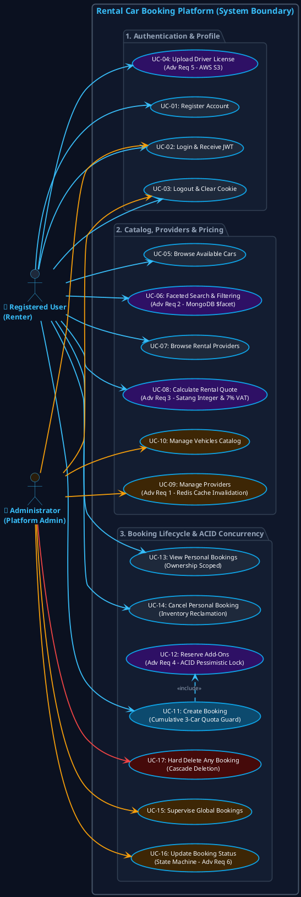

# Rental Car Booking Platform: Use Case Diagram

> **Rendered Diagram**: [use_case_diagram.png](./use_case_diagram.png) (Presentation Slide 5)  
> **PlantUML Source**: [use_case_diagram.puml](./use_case_diagram.puml)

